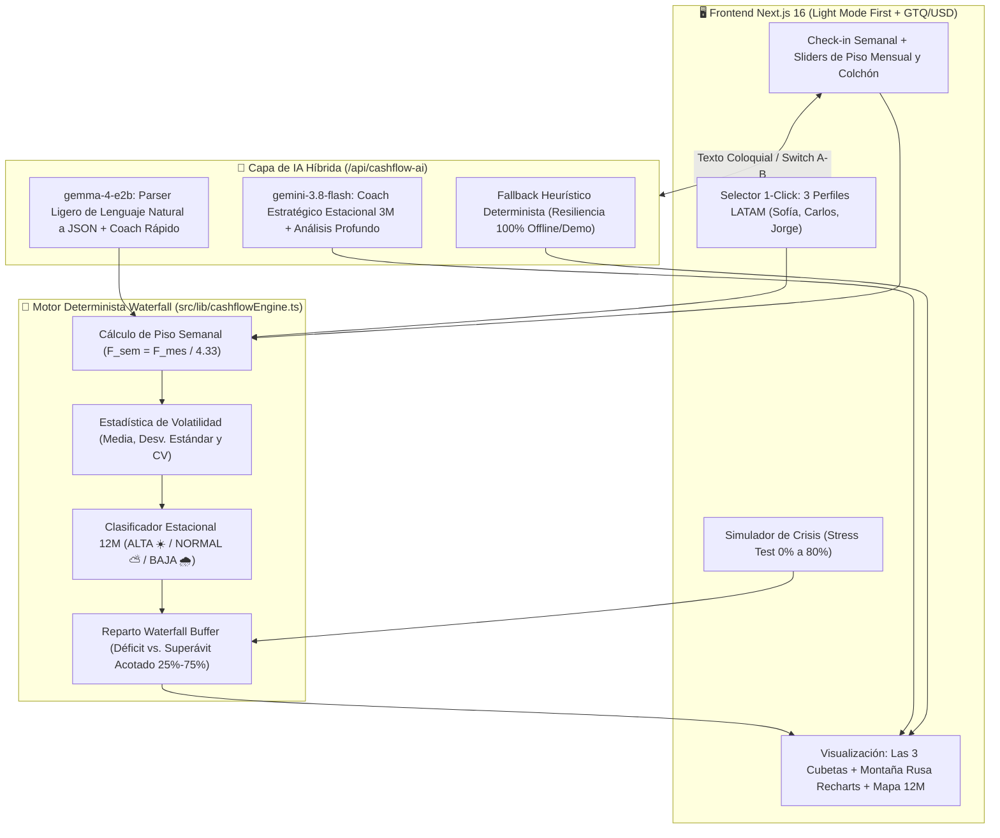
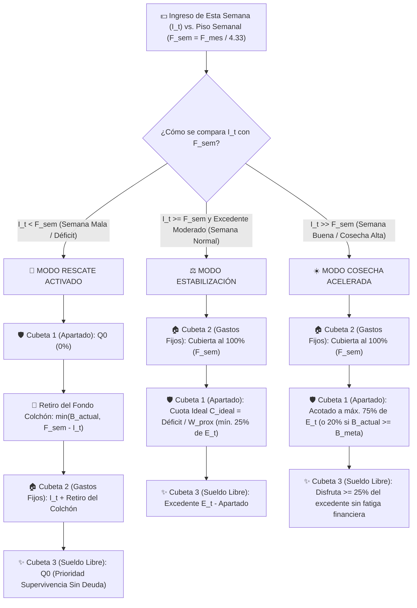
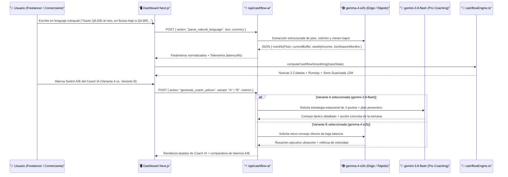

# 🌊 Freelance Cashflow Smoother (`freelance-cashflow-smoother`)

Dashboard interactivo de estabilización de flujo de caja para trabajadores independientes, comerciantes por comisión y conductores de apps en Guatemala y Latinoamérica. Transforma ingresos semanales volátiles ("la montaña rusa") en una cuota exacta de ahorro estacional y un **sueldo propio estabilizado** en menos de 5 segundos.

> 🚀 **Demo en Vivo (Producción en Vercel):** [**https://freelance-cashflow-smoother.vercel.app**](https://freelance-cashflow-smoother.vercel.app)
>
> 📌 **Especificación del Proyecto:** [`SPEC.md`](./SPEC.md) · 📘 **Guía de Onboarding:** [`docs/ONBOARDING.md`](./docs/ONBOARDING.md) · 🧮 **Motor Matemático:** [`docs/ALGORITHM.md`](./docs/ALGORITHM.md)
>
> 🔗 **Índice General de Prototipos:** [`ykro/hackathon-prototipos-index`](https://github.com/ykro/hackathon-prototipos-index) · 🧪 **Benchmark Gemini 4 Argon & A/B Tests:** [`ykro/gemini-argon-agy-benchmark`](https://github.com/ykro/gemini-argon-agy-benchmark)

---

## 🎯 El Problema vs. La Solución

Los trabajadores independientes y freelancers no fracasan financieramente por ganar poco en el año, sino por la **asimetría estacional**: en los meses de cosecha alta gastan como si el pico fuera permanente, y cuando llega la temporada baja (enero, época de lluvias o pausas de clientes) recurren a endeudamiento caro para cubrir su piso básico de vida.

**Freelance Cashflow Smoother** resuelve esto combinando el algoritmo determinista **Waterfall Buffer** con **IA Híbrida (`gemini-3.8-flash` + `gemma-4-e2b`)** en una interfaz *Light Mode First* bimoneda (`GTQ Q` / `USD $`).

---

## 📥 Tabla Ultra-Clara: INPUTS vs. OUTPUTS y Las 3 Cubetas Semanales

| Bloque | Parámetro / Componente | Descripción y Regla de Negocio |
| :--- | :--- | :--- |
| **📥 INPUT 1: Configuración Base** | `monthlyFloor` ($F_{mes}$) y `currentBuffer` ($B_{actual}$) | **Piso Mensual de Vida** (Vivienda + Comida + Servicios + Transporte) y **Fondo Colchón Actual**. Se configura en 30 segundos con sliders o con los **3 perfiles demo 1-click**. |
| **📥 INPUT 2: Estacionalidad 12M** | `historicalMonths[12]` o Texto en Lenguaje Natural | Serie de 12 meses (Enero–Diciembre) o dictado coloquial procesado por **`gemma-4-e2b`** (*"En noviembre saco Q18,000 pero en enero bajo a Q5,200"*). |
| **📥 INPUT 3: Check-in Semanal** | `weeklyIncome` ($I_t$) | **Único dato recurrente cada viernes:** *"¿Cuánto dinero te entró esta semana?"*. |
| **📊 OUTPUT: Cubeta 1** | 🛡️ **Aparta Hoy (`saveForLowSeason`)** | Cuota exacta en `Q`/`$` y `%` que se transfiere al Fondo de Temporada Baja ($\min(0.75 E_t, \max(0.25 E_t, C_{\text{ideal}}))$). |
| **📊 OUTPUT: Cubeta 2** | 🏠 **Para Tus Gastos Fijos (`fixedCostAllocation`)** | Reserva semanal intocable equivalente a $F_{sem} = F_{mes} / 4.33$ para blindar renta, comida y servicios. |
| **📊 OUTPUT: Cubeta 3** | ✨ **Tu Sueldo Libre Seguro (`safeToSpend`)** | Excedente libre de culpa para gastar esta semana. Si $I_t < F_{sem}$ (*Semana en Déficit*), indica **$0 a apartar** y **cuánto retirar del Fondo Colchón** (`withdrawFromBuffer`). |
| **📊 OUTPUT: Salud y Clima** | **Runway + Gráfica Montaña Rusa + Mapa 12M** | **Semanas de Oxígeno** ($B_{actual} / F_{sem}$), Coeficiente de Variación ($CV$), comparativa **Ingresos Reales vs. Sueldo Estabilizado**, Simulador de Crisis y Coach IA A/B. |

---

## 🏗️ Diagramas de Arquitectura y Flujo del Sistema

### Diagrama 1: Arquitectura del Sistema (UI Light Mode + Motor Matemático Waterfall + IA Híbrida `gemma-4` / `gemini-3.8-flash`)



---

### Diagrama 2: Árbol de Decisión del Algoritmo Waterfall Buffer (Semana Buena vs. Semana Normal vs. Semana Mala)



---

### Diagrama 3: Flujo de Onboarding en Lenguaje Natural y Prueba A/B de Coaching Estacional



---

## 🛠️ Inicio Rápido y Documentación Detallada

```bash
npm install
npm run dev
# Abre http://localhost:3000
```

- 📘 **Cómo configurar el proyecto, usar el modo bimoneda `GTQ`/`USD` y probar los 3 perfiles:** Lee [`docs/ONBOARDING.md`](./docs/ONBOARDING.md).
- 🧮 **Fórmulas exactas de $F_{sem}$, $CV$, $B_{meta}$, $W_{\text{prox}}$ y el Stress Test:** Lee [`docs/ALGORITHM.md`](./docs/ALGORITHM.md).
- 📋 **Alcance original del hackathon y plan de entregables:** Lee [`SPEC.md`](./SPEC.md).
