# Estabilizador (`freelance-cashflow-smoother`)

**Presupuesto para ingresos variables**: para trabajadores informales o freelancers, **aprende tus meses o semanas buenas y malas y calcula cuanto apartar cada semana para no quedarte sin dinero en temporada baja**.

> **Demo en Vivo:** [**https://freelance-cashflow-smoother.vercel.app**](https://freelance-cashflow-smoother.vercel.app)
>
> **Especificacion:** [`SPEC.md`](./SPEC.md) · **Arquitectura:** [`docs/ARCHITECTURE.md`](./docs/ARCHITECTURE.md) · **Onboarding:** [`docs/ONBOARDING.md`](./docs/ONBOARDING.md) · **Motor Matematico:** [`docs/ALGORITHM.md`](./docs/ALGORITHM.md)

---

## El Problema y la Solucion

Los trabajadores independientes, comerciantes informales y freelancers sufren por la **asimetria estacional**: en los periodos de cosecha alta gastan como si el ingreso extraordinario fuera permanente, y cuando llega la temporada baja recurren a deuda para cubrir sus gastos fijos.

**Estabilizador** organiza el presupuesto en **3 pantallas** (`1. Ingresos` · `2. Gastos` · `3. Tu Plan`) con soporte en Quetzales (`Q`) y Dolares (`$`):

1. **1. Ingresos:** Captura de los ultimos meses (`Por Mes`) o semanas (`Por Semana`) en `Q` y `$`, clasificando cada periodo como `Alta`, `Normal` o `Baja`.
2. **2. Gastos:** Registro de gastos esenciales fijos y reserva disponible actual en `Q` y `$`.
3. **3. Tu Plan:** Combina en una sola vista las metricas clave (`Apartar cada semana`, `Sueldo seguro disponible` y comparativa de temporadas) junto con la grafica interactiva `Ingreso Real vs. Sueldo Estabilizado` y el simulador de temporada baja (`-50%`) y alta (`+50%`).

---

## Flujo de la Aplicacion



| Pagina | Componentes | Funcion |
| :--- | :--- | :--- |
| **1. Ingresos** | Selector `Por Mes` / `Por Semana`, 3 perfiles de ejemplo y lista de periodos (`Q` y `$`) | Registra ingresos historicos y detecta automaticamente si cada periodo fue `Alta`, `Normal` o `Baja`. |
| **2. Gastos** | Tarjetas de `Gastos esenciales fijos` y `Reserva disponible hoy` (`Q` y `$`) | Define el piso de gastos fijos y el colchon disponible. |
| **3. Tu Plan** | Metricas de ahorro semanal, sueldo seguro, barras de temporadas, grafica `CashflowChart` y simulador (`-50%` a `+50%`) | Muestra en la misma pantalla cuanto apartar cada semana, el sueldo estable y la grafica interactiva de ingreso real frente a estabilizado. |

---

## Motor de Estabilizacion Estacional



---

## Temas para Artículos Técnicos y de Producto

1. **Algoritmos de suavizado estacional de ingresos para trabajadores independientes y economía informal:** Cómo modelar la asimetría entre semanas o meses de cosecha alta y temporada baja para calcular automáticamente cuánto apartar en los períodos buenos y cuál es el sueldo seguro disponible sin caer en endeudamiento.
2. **Presupuestos bimonetarios nativos (`GTQ Q` y `USD $`) en mercados latinoamericanos:** Por qué las herramientas de presupuesto de una sola moneda fallan cuando conviven ingresos en dólares (contratos remotos, exportaciones o remesas) con gastos esenciales en moneda local, y cómo diseñar un motor financiero que opere ambas monedas en paralelo.
3. **Diseño de interfaces financieras de baja fricción — De hojas de cálculo complejas a un flujo de 3 pantallas con simulación en vivo:** Cómo separar la captura de ingresos y gastos de la vista de decisión (`Tu Plan`), integrando en una sola pantalla las métricas esenciales y la gráfica interactiva de ingreso real frente a sueldo estabilizado con simulación de caídas y subidas (`-50%` a `+50%`).
4. **Formulación matemática del motor `calculateSmoothing` y cálculo dinámico de retención (`computeDynamicTargetPct`) en TypeScript:** Implementación de detección automática de regímenes estacionales (`>= 1.15x` temporada alta, `<= 0.85x` temporada baja), coeficiente de variación de ingresos y acotamiento de la cuota de ahorro semanal entre `5%` y `45%`.
5. **Normalización temporal reversible (`Por Mes` <-> `Por Semana` con factor `4.333`) y aritmética bimonetaria sin deriva por redondeo:** Cómo transformar series históricas de ingresos al cambiar la unidad de tiempo en vivo preservando la exactitud de los flujos independientes en Quetzales y Dólares.
6. **Optimización de simulaciones financieras interactivas en React con `useMemo` y Recharts:** Cómo recalcular instantáneamente en el cliente la curva estabilizada, el superávit de cosecha alta, el retiro de reserva en temporada baja y las semanas de liquidez (*runway*) ante cambios del deslizador de estrés (`-50%` a `+50%`).

---

## Desarrollo Local

```bash
npm install
npm run dev
# Abre http://localhost:3000
```

- **Arquitectura:** [`docs/ARCHITECTURE.md`](./docs/ARCHITECTURE.md)
- **Guia de uso y pruebas:** [`docs/ONBOARDING.md`](./docs/ONBOARDING.md)
- **Formulas del motor:** [`docs/ALGORITHM.md`](./docs/ALGORITHM.md)
- **Especificacion funcional:** [`SPEC.md`](./SPEC.md)
