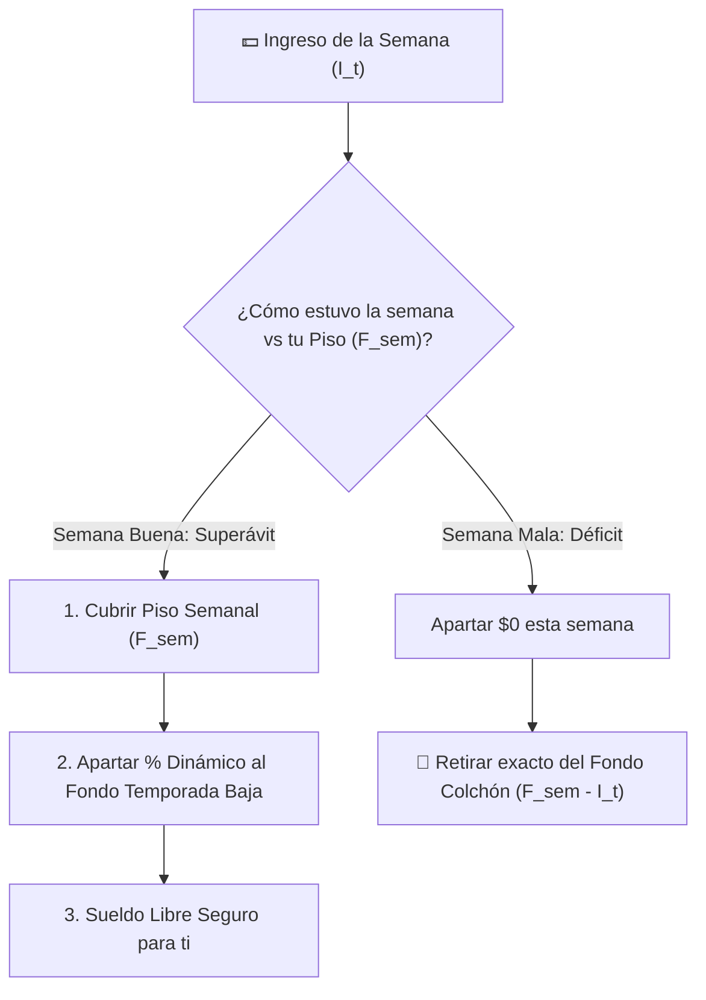

# 📋 Especificación del Proyecto: Freelance Cashflow Smoother

**Objetivo:** Construir en **1 semana (formato Hackathon)** una aplicación financiera para trabajadores informales y freelancers que analice la volatilidad de sus ingresos, identifique temporadas altas y bajas, y calcule una **cuota semanal dinámica de ahorro/reserva** para garantizar liquidez todo el año.

---

## 1. Alcance del MVP (Qué entra y qué NO entra en 1 semana)

### ✅ In-Scope (Lo que sí construiremos)
1. **Onboarding Ultra-Rápido de Ingresos y Gastos Base:**
   - Opción A: Subir un CSV/Excel simple o seleccionar uno de 3 perfiles pre-cargados (ej. *Diseñador Freelance*, *Comerciante / Vendedor por Comisión*, *Conductor de App / Repartidor*).
   - Opción B: Ingreso rápido de sus gastos fijos mensuales indispensables ("Piso de Vida": renta, comida, servicios) y sus ingresos de los últimos 6 meses.
2. **Detector de Meses Buenos y Malos (Seasonal Profiling):**
   - Clasifica automáticamente cada mes histórico en **Temporada Alta (Feast)**, **Normal**, o **Temporada Baja (Famine)** según la desviación respecto a su media móvil y su piso de gastos.
3. **Calculadora Semanal "Cuánto Apartar Hoy" (Waterfall Buffer Algorithm):**
   - El usuario ingresa cuánto ganó esta semana.
   - El algoritmo calcula al instante la división en 3 cubetas:
     1. 🛡️ **Apartado para Temporada Baja** (monto exacto en $ y % a guardar).
     2. 🏠 **Cuota para Gastos Fijos del Mes**.
     3. ✨ **Libre para Gastar esta Semana (Tu "Sueldo Semanal")**.
4. **Simulador "Qué Pasa Si..." (Stress Test):**
   - Un slider interactivo donde el usuario prueba: *"¿Qué pasa si mis próximas 4 semanas son malas (ingreso cae 50%)?"* y ve cómo su fondo colchón absorbe el golpe sin dejarlo en cero.

### ❌ Out-of-Scope (Para evitar retrasos en la semana)
- Transferencias bancarias reales o creación de cuentas custodia reguladas (fintech banking real).
- Contabilidad fiscal compleja multi-país (impuestos se manejan como un porcentaje configurable simple opcional).

---

## 2. El Algoritmo ("Waterfall Cashflow Smoothing")

Para que sea sólido pero implementable en un hackathon, usamos un modelo determinista transparente apoyado por IA para explicaciones:

### Variables Clave
- $F_{mes}$: Gastos fijos mensuales indispensables (*Floor* o Piso de Vida).
- $F_{sem} = F_{mes} / 4.33$: Costo mínimo semanal para vivir.
- $\mu_{sem}$ y $\sigma_{sem}$: Promedio y desviación estándar del ingreso semanal histórico.
- $CV = \sigma_{sem} / \mu_{sem}$: Coeficiente de variación (qué tan inestable es el trabajador).
- $M_{meta} = F_{sem} \times \text{Semanas de Temporada Baja Esperadas}$: Meta del Fondo de Estabilización (típicamente entre 4 y 12 semanas según su $CV$).

### Regla de Decisión Semanal (Dado el ingreso de esta semana $I_t$)
1. **Semana Buena ($I_t > \mu_{sem}$ o $I_t > 1.2 \times F_{sem}$):**
   - Primero se cubre $F_{sem}$ (Gastos base).
   - Del excedente $(I_t - F_{sem})$, se aparta una fracción progresiva $\alpha \in [30\%, 70\%]$ hacia el **Fondo de Temporada Baja**, ponderada por qué tan lleno está el fondo actual ($B_{actual} / M_{meta}$) y qué tan cerca está su próximo "mes malo" histórico.
2. **Semana Normal ($F_{sem} \le I_t \le 1.2 \times F_{sem}$):**
   - Se cubre $F_{sem}$ y se aparta un micro-ahorro base (10%–15% del excedente).
3. **Semana Mala ($I_t < F_{sem}$):**
   - **Apartado = $0**.
   - El sistema indica **cuánto retirar del Fondo de Temporada Baja** ($\text{Retiro} = F_{sem} - I_t$) para que el trabajador complete su semana sin endeudarse.

---

## 3. Plan de Trabajo de 1 Semana (Día a Día)

| Día | Meta Principal | Entregable |
| :--- | :--- | :--- |
| **Día 1** | Motor del Algoritmo & Datasets Sintéticos | Función en TypeScript/Python con el cálculo del *Waterfall Buffer* + 3 datasets realistas de 12 meses (Freelancer, Comerciante informal, Conductor de app). |
| **Día 2** | UI Principal: "Mi Semana" + Calculadora de Apartado | Pantalla donde el usuario mete cuánto ganó esta semana y ve con barras claras cuánto apartar hoy y su "Sueldo Seguro". |
| **Día 3** | Gráfica "Montaña Rusa vs. Sueldo Estabilizado" | Gráfica dual en Recharts que muestra la línea roja (ingresos reales volátiles) vs. la línea verde (su flujo estabilizado gracias al fondo colchón). |
| **Día 4** | Mapa de Calor de Meses Buenos y Malos + IA Coach | Calendario anual identificando meses críticos históricos y recomendaciones en lenguaje natural (ej. *"Octubre suele ser tu mes más fuerte; apartando $850/semana llegarás blindado a Enero"*). |
| **Día 5** | Simulador de Crisis ("Stress Test") | Slider interactivo para simular una racha de 3–6 semanas malas y mostrar el indicador de *Semanas de Oxígeno (Runway)*. |
| **Día 6** | Pulido Mobile-First y Recordatorio Semanal | Diseño adaptable a celular (fundamental para trabajadores informales) + simulación de notificación por WhatsApp/Web ("¡Viernes de cierre! ¿Cuánto ingresó esta semana?"). |
| **Día 7** | Demo y Pitch | Comparativa visual del antes (quedarse en $0 en temporada baja) y después (paz mental todo el año). |

---

## 4. Qué hace ganador a este proyecto en un Hackathon
1. **Impacto Social y Financiero Real:** Ataca a un segmento enorme e ignorado por la banca tradicional (economía informal y gig workers en LATAM).
2. **Acción Concreta Semanal:** No abruma con 50 categorías contables; responde una sola pregunta vital cada viernes: *"De lo que gané esta semana, ¿cuánto guardo y cuánto puedo gastar sin miedo?"*
3. **Visualización "Antes vs. Después":** La gráfica que aplana la curva de ingresos volátiles vende el proyecto en 5 segundos ante el jurado.
